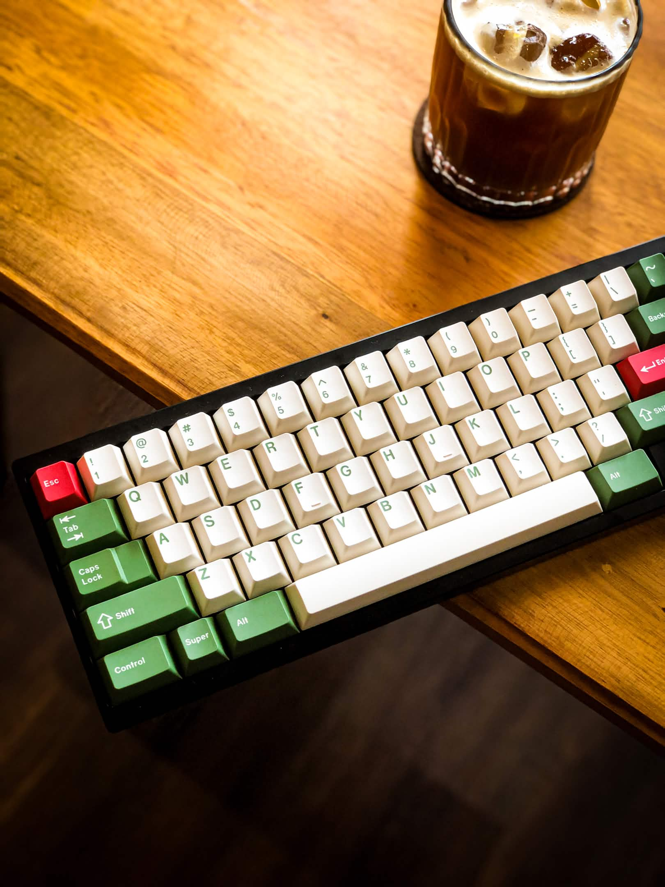
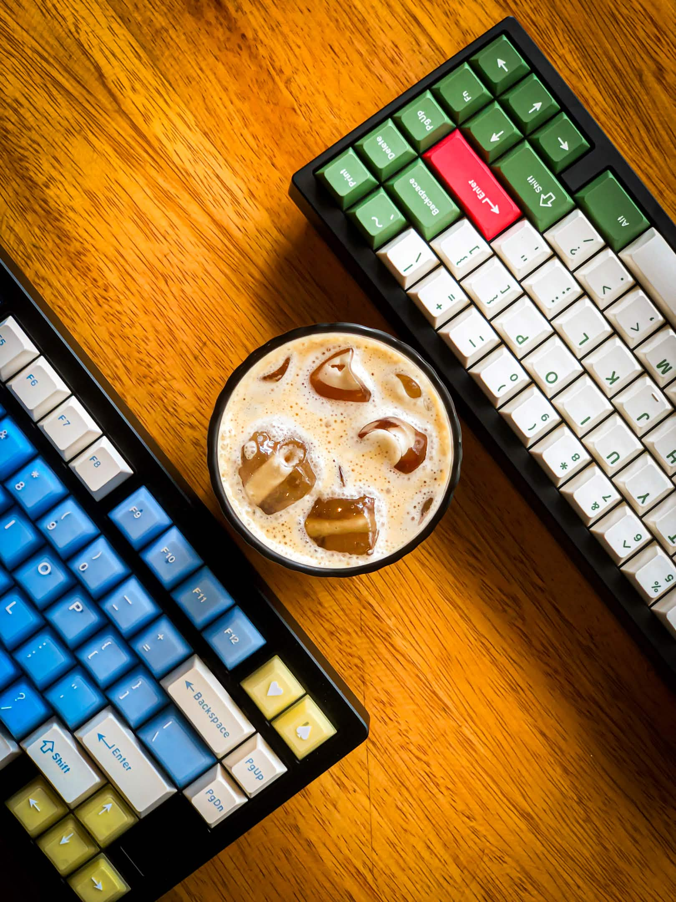
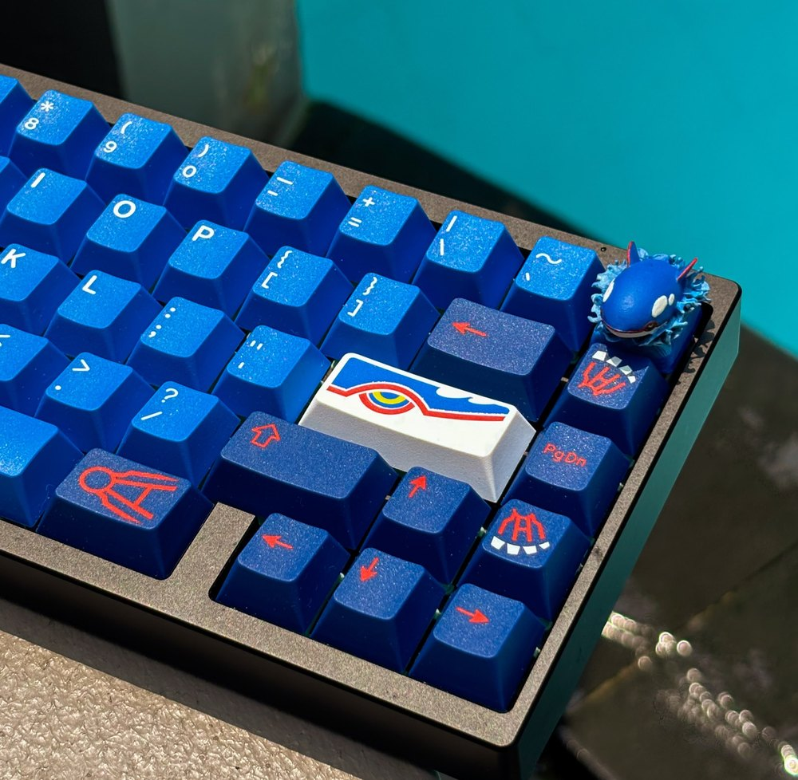
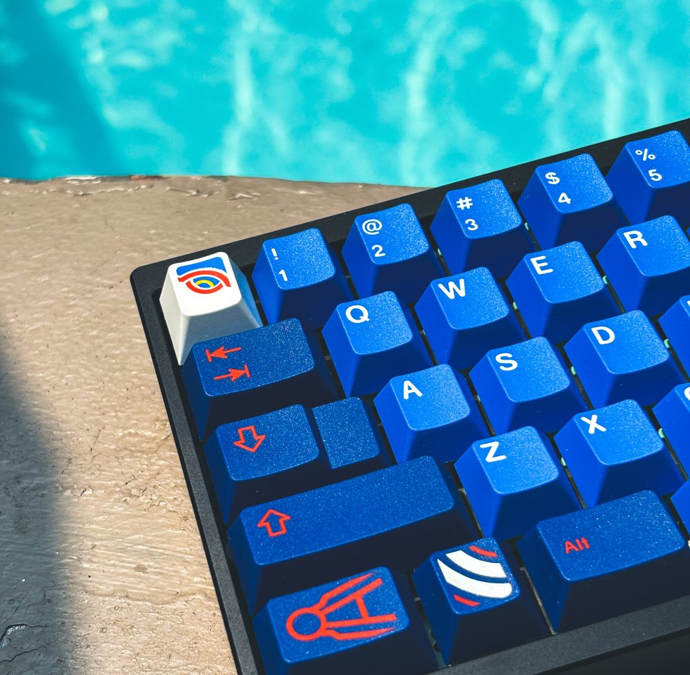

<picture>
  <source media="(prefers-color-scheme: dark)" srcset="./assets/header-dark.svg">
  <source media="(prefers-color-scheme: light)" srcset="./assets/header-light.svg">
  
</picture>

  

<picture>
  <source media="(prefers-color-scheme: dark)" srcset="./assets/section-rule-dark.svg">
  <source media="(prefers-color-scheme: light)" srcset="./assets/section-rule-light.svg">
  
</picture>

### About

I'm a fullstack developer building web apps and business systems that real teams rely on every day. I care about making things that are fast, clear, and actually make people's work easier. Whether it's a landing page, a dashboard, or a full system, I want to build software that helps businesses grow.

Before tech, I spent years in F&B as an Assistant Operations Manager, so I know what it's like to run a business on the ground. That's why I build with the people using it in mind.

<picture>
  <source media="(prefers-color-scheme: dark)" srcset="./assets/section-rule-dark.svg">
  <source media="(prefers-color-scheme: light)" srcset="./assets/section-rule-light.svg">
  
</picture>

### Stack

  
  
  
  
  
  
  
  
  
  
  
  

  
Full stack list

   

| | |
|:--|:--|
| **Languages** | JavaScript · TypeScript · PHP · SQL · Git |
| **Front end** | React · Next.js · Vue · Nuxt · Vite · React Native · Expo · Redux Toolkit · Tailwind CSS · Bootstrap · Axios · Apollo Client |
| **Back end** | Laravel · Node.js · Express · NestJS · Sequelize · PostgreSQL · MySQL · MongoDB · Redis · REST API · GraphQL · Docker · GCP · AWS · Firebase · Socket.IO |

<picture>
  <source media="(prefers-color-scheme: dark)" srcset="./assets/section-rule-dark.svg">
  <source media="(prefers-color-scheme: light)" srcset="./assets/section-rule-light.svg">
  
</picture>

### On GitHub

<picture>
  <source media="(prefers-color-scheme: dark)" srcset="https://github-readme-stats.vercel.app/api?username=watisdis31&show_icons=true&hide_border=true&bg_color=141210&title_color=c45a4a&text_color=f5f2ec&icon_color=7a9a74&rank_icon=percentile&hide=stars">
  
</picture>
<picture>
  <source media="(prefers-color-scheme: dark)" srcset="https://github-readme-streak-stats.herokuapp.com/?user=watisdis31&hide_border=true&background=141210&stroke=8a2e24&ring=c45a4a&fire=8a2e24&currStreakLabel=7a9a74&sideNums=f5f2ec&currStreakNum=f5f2ec&sideLabels=f5f2ec&dates=f5f2ec">
  
</picture>

<picture>
  <source media="(prefers-color-scheme: dark)" srcset="./assets/section-rule-dark.svg">
  <source media="(prefers-color-scheme: light)" srcset="./assets/section-rule-light.svg">
  
</picture>

### Selected work

| Project | Notes |
|:--|:--|
| [Split Bill Calculator v2](https://github.com/watisdis31/Split-Bill-Calculator-v2) | Split a bill from a receipt photo, then share a link so friends can claim their items |
| [PendengarMu](https://github.com/Final-Project-H8-FSJS-RMT-069-P3/pendengarMu) | Hacktiv8 final project that matches users with psychiatrists, with live chat and video calls |
| [UKEA](https://github.com/watisdis31/ukea-frontend-vercel) | Hacktiv8 e commerce app for staff to manage stock and sales, with admin and staff roles |
| [Pokedex](https://github.com/watisdis31/pokedex-project-frontend) | Pokémon database with a team builder and AI build tips |

  <a href="https://github.com/watisdis31/Split-Bill-Calculator-v2">
    <picture>
      <source media="(prefers-color-scheme: dark)" srcset="https://github-readme-stats.vercel.app/api/pin/?username=watisdis31&repo=Split-Bill-Calculator-v2&hide_border=true&bg_color=141210&title_color=c45a4a&text_color=f5f2ec&icon_color=7a9a74">
      
    </picture>
  </a>
  <a href="https://github.com/watisdis31/pokedex-project-frontend">
    <picture>
      <source media="(prefers-color-scheme: dark)" srcset="https://github-readme-stats.vercel.app/api/pin/?username=watisdis31&repo=pokedex-project-frontend&hide_border=true&bg_color=141210&title_color=c45a4a&text_color=f5f2ec&icon_color=7a9a74">
      
    </picture>
  </a>

<picture>
  <source media="(prefers-color-scheme: dark)" srcset="./assets/section-rule-dark.svg">
  <source media="(prefers-color-scheme: light)" srcset="./assets/section-rule-light.svg">
  
</picture>

### Connect

  
  
  
  
  

<picture>
  <source media="(prefers-color-scheme: dark)" srcset="./assets/section-rule-dark.svg">
  <source media="(prefers-color-scheme: light)" srcset="./assets/section-rule-light.svg">
  
</picture>

### Off the clock

I build custom mechanical keyboards when I am not coding.

<table>
  <tr>
    <td width="50%"></td>
    <td width="50%"></td>
  </tr>
  <tr>
    <td width="50%"></td>
    <td width="50%"></td>
  </tr>
</table>