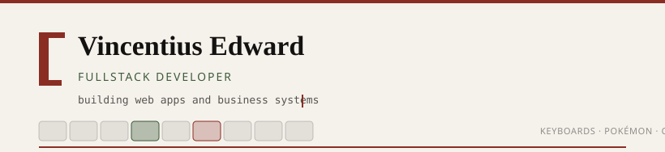

<picture>
  <source media="(prefers-color-scheme: dark)" srcset="./assets/header-dark.svg">
  <source media="(prefers-color-scheme: light)" srcset="./assets/header-light.svg">
  
</picture>

## About

I'm a fullstack developer building web apps and business systems that real teams rely on every day. I care about making things that are fast, clear, and actually make people's work easier. Whether it's a landing page, a dashboard, or a full system, I want to build software that helps businesses grow.

Before tech, I spent years in F&B as an Assistant Operations Manager, so I know what it's like to run a business on the ground. That's why I build with the people using it in mind.

## Stack

  
  &nbsp;&nbsp;
  
  &nbsp;&nbsp;
  
  &nbsp;&nbsp;
  
  &nbsp;&nbsp;
  
  &nbsp;&nbsp;
  

| | |
|:--|:--|
| **Languages** | JavaScript · TypeScript · PHP · SQL · Git |
| **Front end** | React · Next.js · Vue · Nuxt · Vite · React Native · Expo · Redux Toolkit · Tailwind CSS · Bootstrap · Axios · Apollo Client |
| **Back end** | Laravel · Node.js · Express · NestJS · Sequelize · PostgreSQL · MySQL · MongoDB · Redis · REST API · GraphQL · Docker · GCP · AWS · Firebase · Socket.IO |

## Selected work

| Project | Notes |
|:--|:--|
| [Split Bill Calculator v2](https://github.com/watisdis31/Split-Bill-Calculator-v2) | Shared expenses, split fairly, settle up |
| [PendengarMu](https://github.com/Final-Project-H8-FSJS-RMT-069-P3/pendengarMu) | Mental health support app (Hacktiv8 final project) |
| [UKEA](https://github.com/watisdis31/ukea-frontend-vercel) | Frontend for a community and events platform |
| [Pokedex](https://github.com/watisdis31/pokedex-project-frontend) | Pokémon browser built with React |

## Connect

[LinkedIn](https://www.linkedin.com/in/vincentius-edward-8905509a/) · [JobStreet](https://id.jobstreet.com/profiles/vincentius-edward-0HHJD5sz33) · [Portfolio](https://watisdis31.web.id) · [YouTube](https://www.youtube.com/@margarinevince) · [Instagram](https://www.instagram.com/v.edw31/)

## Off the clock

I build custom mechanical keyboards when I am not coding.

<table>
  <tr>
    <td></td>
    <td></td>
  </tr>
</table>